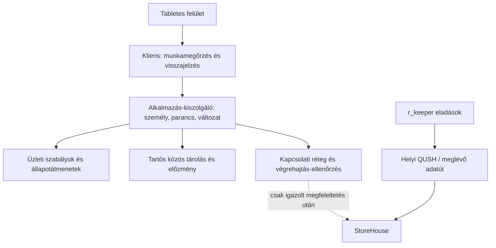

# A raktárkezelő alkalmazás rétegei

2026. október 27. · A felhasználó által kért működési alapok megvalósítási szerkezete. A helyszíni r_keeper/StoreHouse-kapcsolat nincs igazolva. A helyi bizonyítékot az [alapok megvalósítása](alapok-megvalositasa.md) tartalmazza.

## Miért külön rétegek?

A dolgozó ugyanazt az érthető felületet használja akkor is, amikor az adat a tesztüzemből, és akkor is, amikor később a valódi StoreHouse-ból származik. A képernyő nem dönthet a külső bizonylat létrejöttéről, és nem számolhat önálló, második kasszafogyást. A kapcsolat cseréje több egy URL beírásánál: a valódi rendszer termék-, hely-, egység- és bizonylatkapcsolatait, végrehajtási jogait és visszaolvasását külön igazolni kell.

A jelenlegi közös kiszolgáló **tesztüzemet** futtat. A StoreHouse felé vezető ág nincs bekötve; nincs automatikus helyettesítő mintaadat-visszatérés éles kapcsolat hibájánál.

## Felelősségek

| Réteg | Feladata | Ami nem a feladata |
| --- | --- | --- |
| `demo/app.mjs`, `template.html`, `style.css` | Magyar munkafolyamat, termékválasztás, ellenőrző összefoglaló, következő felelős, javítható hiba. | StoreHouse-jelszó, könyvelés sikerének kitalálása, jogosultság önkényes megadása. |
| `demo/runtime.mjs` | Bejelentkezés, parancsküldés, friss állapot és személyhez kötött piszkozat, bizonytalan válasz visszaellenőrzése. Az önálló HTML helyi módját külön jelzi. | Éles üzleti jogosultság megállapítása, automatikus offline könyvelés. |
| `src/domain/inventory.mjs` | Tiszta üzleti állapotátmenet: mennyiség, hely, szerep, átadás, eltérés, műszak, számolás és történeti tételadat. Az időt és eljárót a hívó adja. | Hálózat, adatbázis, konkrét StoreHouse-végpont. |
| `src/application/`, `server/` | Hitelesített eljáró, szerveridő, egyedi parancs, állapotváltozat, atomi tárolás és közös adat. | A kliens által küldött szerep vagy személynév megbízhatónak tekintése. |
| `src/integrations/` | Külső művelet terve, részeredménye, visszaigazolt/bizonytalan állapota és ellenőrzött rendezése. | Ismeretlen helyi eljárás vagy sikeres StoreHouse-könyvelés feltételezése. |
| `data/test-catalog.mjs` | PDF-ből ellenőrzött nyomtatott termékadatok és forrásjelölés a teszthez. | Mai készlet, ellenőrzött API-azonosító vagy névből kitalált kiszerelési szorzó. |

A `demo/model.mjs` a korábbi helyi importok kompatibilitási bejárata; az üzleti szabályok közös forrása a domainréteg. A tesztadat és az adatbázisban tárolt üzleti állapot külön fogalom.

## Egy parancs életútja

A felület az ellenőrzött beküldéshez egyedi parancsazonosítót és a látott állapot változatszámát adja. A kiszolgáló az eljáró személyt a bejelentkezett munkamenetből veszi. Ugyanannak a parancsnak az ismétlése a korábbi eredményt adja vissza; ugyanaz az azonosító más tartalommal nem használható. Az elavult állapotból érkező új művelet nem írja felül a közben elvégzett munkát: a felület friss adatot és ellenőrzési lépést ad.

A közös állapot és a végrehajtott parancs eredménye egy adatbázis-műveletben rögzül. Az eszköz megszakadt kapcsolata így nem törli el azt a tényt, hogy egy parancs már végrehajtódott. A válasz elvesztésekor a kliens az azonosító alapján előbb ellenőrzi az eredményt; nem indít észrevétlenül új bizonylatot.

A böngészőből küldött időpont nem írja felül a kiszolgáló idejét. Az app budapesti idő szerint jelenít meg, a tárolt pillanat időzónát is tartalmaz. A szerveróra helyessége üzemeltetési feladat; a helyi teszt nem helyettesíti a gépek üzemi időszinkronját.

## A későbbi külső könyvelés határa

Egy több célraktáras bevételezéshez a telepített StoreHouse több kapcsolódó bizonylatot is igényelhet. Az appnak a részeket és az egész műveletet is követnie kell. Egyetlen sikeres rész nem teheti sikeressé az összeset. A külső kapcsolat számára tartós végrehajtási sor tartozik az alkalmazásművelethez; a küldött, bizonytalan, visszaigazolt és elutasított eredmény elkülönül.

Időtúllépés után nem feltételezhető sem az, hogy a külső írás sikerült, sem az, hogy nem történt semmi. Az adott művelet ellenőrzése és a StoreHouse-ban található eredmény egyeztetése előzi meg az esetleges ismétlést. A tesztek erre külön mesterséges adaptert használhatnak; ez tesztbizonyíték, nem tényleges helyszíni képesség.

Az éles illesztés előtt legalább a következők szükségesek:

1. Valódi termék-, egység-, raktár- és bizonylatazonosítók megfeleltetése. A PDF nyomtatott kódja önmagában nem API-azonosító.
2. Az átadás alatti készlet és részleges igazolás StoreHouse-beli időzítése (NYIT-06).
3. Bizonylatlétrehozás, jóváhagyás, helyesbítés, lekérdezés és bizonytalan eredmény rendezése a konkrét telepítésen (NYIT-05–08).
4. A kassza-, italcsomag- és receptfogyás frissességének ellenőrzése; ugyanaz a fogyás egyszer hasson (FOGY-01–05, NYIT-03–04/14).
5. Tesztadatoktól elkülönített üzem, valós dolgozók és jogosultságok, titokkezelés, TLS és helyszíni próba.

A jelenlegi `--live` indítás és a kifejezett `--test` nélküli indítás megtagadott. Az ellenőrzött helyi közös üzem Node.js 24-re és SQLite-ra épül; az alapértelmezett cím `127.0.0.1:4174`, az adatbázis `.local/warehouse-test.sqlite`. Az éles StoreHouse-adapter hiányát nem fedheti el a helyi tesztkészlet.

## Piszkozat, személy és helyreállítás

A piszkozat nem végleges készletművelet. A mentési jelzés csak sikeres mentés után állíthatja, hogy a munka megmaradt, és jeleznie kell, hogy az adott készüléken vagy a közös kiszolgálón található. A következő dolgozó nem örökli észrevétlenül az előző személyét vagy piszkozatát. A kiszolgáló a várt személyazonosságot és a piszkozat saját változatát is ellenőrzi: két tablet ugyanannak a dolgozónak a piszkozatát sem írhatja felül észrevétlenül. A tartós piszkozat-sorozat törlés/újralétrehozás után is megkülönbözteti az új példányt. Visszakapcsolódáskor a rögzítés ellenőrzés után küldhető be; nincs automatikus utókönyvelés.

A helyi adatbázis mentése az állapot mellett a parancsazonosítókat, előzményt és piszkozatokat is őrzi. A visszaállítás új céladatbázisba történik; egy meglévő üzemi állapot felülírása nem mellékhatása a próbának. A mentési és visszaállítási parancsok konkrét használatát az [indítási útmutató](../demo/README.md) rögzíti a megvalósítás ellenőrzése után.
